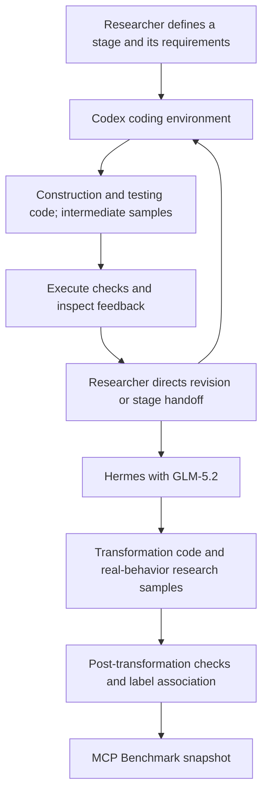

# MCP Benchmark 1.0

[中文说明](README.zh-CN.md)

This project releases **an MCP security benchmark** and **the researcher-directed harness + LLM method used to construct it**. The contribution includes the dataset and the staged use of coding agents to produce construction, testing and transformation code. That code is an artifact of the method.

The researcher used **Codex** for construction and testing code, then **Hermes with GLM-5.2** for the transformation stage introducing real malicious behavior into research samples. The researcher issued instructions and advanced the work stage by stage. This was not an unattended autonomous pipeline.

## Start here

| Resource | Contents |
|---|---|
| [Benchmark](benchmark/README.md) | 1,025 samples, labels, provenance, reading and integrity tools |
| [Method](method/README.md) | Harness/model roles, stage handoffs, transformation and verification semantics |
| [Implementation artifacts](construction/README.md) | Final construction, testing, transformation and export code |
| [Reproduction](construction/REPRODUCTION.md) | Environment setup, controlled tests and reproduction boundaries |
| [Release notes](RELEASE_NOTES.md) | Candidate scope and verification results |

## Dataset

| Subset | Samples | Role |
|---|---:|---|
| Connor | 130 | Imported benign samples |
| Sentinel | 210 | Imported benign samples |
| Five constructed bases, L0–L2 | 175 | Baseline, benign suggestion and gray stress-test controls |
| Five constructed bases, L3 | 510 | Constructed malicious samples |
| **Total** | **1,025** | |

The bases are DevSpace, DocForge, KeyVault, NoteVault and ScaffoldKit. Each has 137 samples: 1 L0, 17 L1, 17 L2 and 102 L3. Imported benign samples are separate from the 685 constructed samples. Report L2 as a gray/stress subset rather than silently treating it as an ordinary benign control.

## Read without running sample code

Python 3.12 or later is sufficient for these standard-library commands, run from the repository root:

```console
python benchmark/tools/catalog.py stats
python benchmark/tools/catalog.py verify
python benchmark/tools/catalog.py read --base keyvault --limit 2
```

These commands read labels and source files. They do not import, install or launch sample servers. `verify` exits nonzero on a mismatch.

## Construction method



The [method](method/README.md) separates code generation, intermediate trigger testing, structural checks and final behavior validation. Model/harness roles are reported by the researcher; unspecified versions and historical run statistics are not inferred from the source tree.

## Research use and attribution

This repository is intended for MCP security research, detector evaluation and experiments in authorized environments. It contains dangerous sample code. Read [SECURITY.md](SECURITY.md) before dynamic work. The quick start and release checks do not execute original dangerous samples.

Part of the benign corpus is drawn from the open-source [Connor project](https://github.com/yiheng98/Connor), particularly its [benign dataset](https://github.com/yiheng98/Connor/tree/main/Dataset/Benign). See [third-party notices](THIRD_PARTY_NOTICES.md). Sentinel rows retain their upstream repository and commit metadata.

Project-original code and metadata are provided under [Apache-2.0](LICENSE). Third-party material retains its existing notices and applicable upstream terms. Cite this repository using [CITATION.cff](CITATION.cff), and acknowledge Connor when using its contributed subset.
