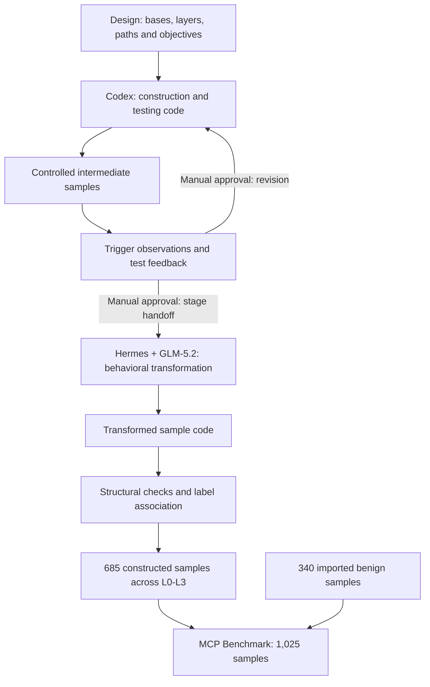

# MCP Benchmark 1.0

[中文说明](README.zh-CN.md)

**An MCP security benchmark and a harness + LLM method for constructing it.**

MCP Benchmark 1.0 provides a corpus of **1,025 labeled MCP samples** for security analysis and detector evaluation. The corpus combines 340 imported benign samples with 685 constructed samples organized by application base, risk layer, influence path and behavioral objective. The project releases the construction methodology and its final implementation artifacts alongside the data.

The methodological focus is **harness-mediated program generation and behavioral transformation**. The project used **Codex** to develop construction and testing code, then **GLM-5.2 within Hermes** to transform intermediate samples into samples containing real malicious behavior. Construction, testing and transformation code are themselves outputs of this process. Tasks are issued separately for each stage, with manual approval governing revisions and stage transitions.

## Research scope

The benchmark is organized around the relationship between **where an MCP interaction can be influenced, which behavior a sample is designed to induce, and what evidence supports its label**. The constructed corpus makes these dimensions explicit, allowing evaluation results to be reported by layer, path and objective instead of only as an aggregate binary classification score. The imported benign subsets provide additional source material collected outside the construction workflow.

When language can become action through a tool, security judgments need to distinguish expressed intent, executable capability and observed consequences. A malicious label condenses a judgment but cannot replace its justification. Paths, objectives and explicit limits on verification make that judgment open to explanation, examination and revision.

The project contributes two connected research artifacts: a versioned dataset with explicit labels and provenance, and a method account explaining the use of coding harnesses and LLMs for data production. The current release establishes the corpus and implementation; detector comparisons and empirical claims about model effectiveness require separate experiments.

## Corpus design

| Subset | Samples | Role |
|---|---:|---|
| Connor | 130 | Imported benign samples |
| Sentinel | 210 | Imported benign samples |
| Five constructed bases, L0–L2 | 175 | Baseline, benign suggestion and gray stress-test controls |
| Five constructed bases, L3 | 510 | Constructed malicious samples |
| **Total** | **1,025** | |

The five bases are **DevSpace, DocForge, KeyVault, NoteVault and ScaffoldKit**. Each contains one L0 baseline, 17 L1 benign-suggestion variants, 17 L2 gray/stress variants and 102 L3 variants combining **17 influence paths with six objective categories**:

`N_constructed = 5 × (1 + 17 + 17 + 17 × 6) = 685`

This design supports analysis within a shared set of bases and path definitions. L2 has a distinct gray/stress role and should be reported separately when interpreting false positives. The corpus is a designed research resource; its dimensions do not establish exhaustive coverage of MCP systems or a representative estimate of real-world prevalence.

## Construction method



The method separates two concerns. **Controlled construction** makes interfaces, influence paths and trigger observations inspectable. **Behavioral transformation**, the central Hermes + GLM-5.2 stage, changes the execution semantics of intermediate samples to include real malicious behavior. The diagram expresses these relationships; stage progression uses manual approval based on available feedback.

The [method account](method/README.md) explains this design and distinguishes the coding harness from the MCP test host. The released programs support the method as implementation artifacts.

## Evidence and reproducibility

The project distinguishes **intermediate trigger observations**, **post-transformation structural checks** and **final behavioral validation**. A reached trigger or a valid source file does not establish that a final malicious effect succeeded. The [release verification](benchmark/metadata/verification.md) records integrity checks, static parsing and controlled tests; it does not report dynamic success rates for the final malicious samples.

The release includes method descriptions, final code, required configuration and the frozen dataset. Original authoring instructions, prompts, conversations and process traces are outside the release scope. Reproduction therefore covers the supported code-level operations, while the historical LLM coding sessions are documented without a claim of exact replay. Unknown model versions and historical run statistics remain unspecified.

## Access and use

| Resource | Contents |
|---|---|
| [Benchmark](benchmark/README.md) | Dataset, label schema, provenance and integrity tools |
| [Method](method/README.md) | Sample design, harness/model roles, transformation and evidence interpretation |
| [Implementation artifacts](construction/README.md) | Final construction, testing, transformation and export code |
| [Reproduction](construction/REPRODUCTION.md) | Environment setup, controlled tests and supported operations |
| [Release notes](RELEASE_NOTES.md) | Candidate scope and verification results |

To read the corpus, use Python 3.12 or later from the repository root:

```console
python benchmark/tools/catalog.py stats
python benchmark/tools/catalog.py verify
python benchmark/tools/catalog.py read --base keyvault --limit 2
```

These standard-library commands read labels and source files without importing, installing or launching sample servers. They require no model API credentials. `verify` exits nonzero on a mismatch.

## Research use and attribution

This repository is intended for MCP security research, detector evaluation and experiments in authorized environments. It contains dangerous sample code. Read [SECURITY.md](SECURITY.md) before dynamic work. The quick start and release checks do not execute original dangerous samples.

Part of the benign corpus is drawn from the open-source [Connor project](https://github.com/yiheng98/Connor), particularly its [benign dataset](https://github.com/yiheng98/Connor/tree/main/Dataset/Benign). See [third-party notices](THIRD_PARTY_NOTICES.md). Sentinel rows retain their upstream repository and commit metadata.

Project-original code and metadata are provided under [Apache-2.0](LICENSE). Third-party material retains its existing notices and applicable upstream terms. Cite this repository using [CITATION.cff](CITATION.cff), and acknowledge Connor when using its contributed subset.
