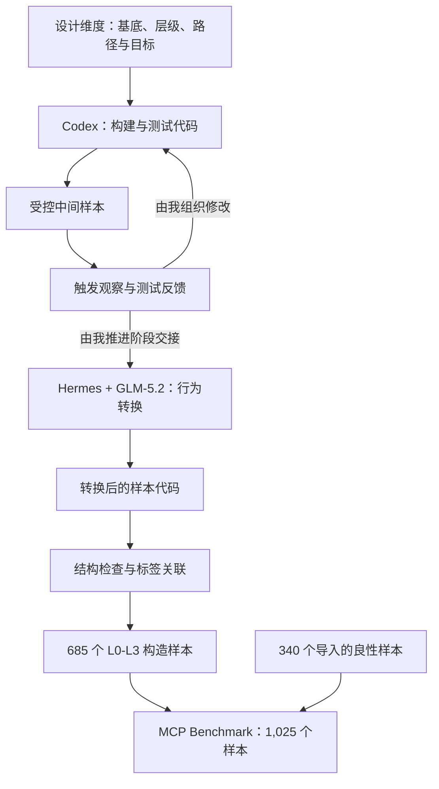

# MCP Benchmark 1.0

[English](README.md)

**面向 MCP 安全评估的基准数据集及其 Harness + LLM 构建方法。**

我在本项目中提出 MCP Benchmark 1.0：一个用于安全分析与检测方法评估的 **1,025 样本标注数据集**。数据集包含 340 个导入的良性样本，以及按应用基底、风险层级、影响路径和行为目标组织的 685 个构造样本。与数据一同公开的，还有构建方法及其最终实现。

方法的重点是 **harness 支持下的程序生成与行为转换**。我使用 **Codex** 编写和迭代构建、测试代码，再在 **Hermes** 中使用 **GLM-5.2**，将中间样本转换为包含真实恶意行为的样本。构建、测试与转换代码本身也是这一过程的产物；各阶段的任务、修改和交接均由我分阶段下达指令推进。

## 研究问题与贡献

我围绕三个相互关联的问题组织这个 benchmark：**MCP 交互在何处受到影响、样本意图诱发什么行为，以及哪些证据能够支持样本标签**。构造子集显式保留这些维度，使评估可以按层级、路径和目标分别展开，并在整体二分类指标之外分析具体差异。导入的良性子集则补充了构建流程之外收集的源码材料。

本项目提供两项相互关联的研究成果：带有明确标签与来源信息的版本化数据集，以及我如何组织编码 harness 与 LLM 完成数据生产的方法说明。当前版本提供数据与实现基础；检测方法的性能比较，以及模型有效性的实证结论，需要通过独立实验建立。

## 数据设计

| 子集 | 数量 | 说明 |
|---|---:|---|
| Connor | 130 | 从已有开源数据导入的良性样本 |
| Sentinel | 210 | 导入的良性样本，保留现有标签及来源信息 |
| 五个基底的 L0–L2 | 175 | 基线、良性建议和灰区压力测试 |
| 五个基底的 L3 | 510 | 构造的恶意样本 |
| **合计** | **1,025** | |

五个基底分别为 **DevSpace、DocForge、KeyVault、NoteVault 和 ScaffoldKit**。每个基底包含 1 个 L0 基线、17 个 L1 良性建议样本、17 个 L2 灰区／压力样本，以及由 **17 条影响路径与六类行为目标**组合得到的 102 个 L3 样本：

`N_constructed = 5 × (1 + 17 + 17 + 17 × 6) = 685`

这一设计支持在共同的基底与路径定义下开展分组分析。L2 具有独立的灰区／压力测试含义，解释误报时应单独报告。该数据集是按既定维度构造的研究资源；这些维度并不意味着穷尽所有 MCP 系统，也不代表现实环境中的风险分布。

## 核心方法



我将方法分为两个相互衔接的部分：**受控构建**使接口、影响路径和触发观察具有可检查的表达；**行为转换**则改变中间样本的执行语义，将真实恶意行为引入最终样本，其中 Hermes + GLM-5.2 是核心环节。图中呈现的是方法关系；实际执行中，我根据已有反馈分别下达任务并决定阶段转换。

[方法说明](method/README.zh-CN.md)进一步解释这一设计，并区分用于代码生成的 harness 与用于样本交互的 MCP 测试工具。公开程序作为方法的实现产物，支撑相应步骤的检查与复现。

## 证据与复现范围

我区分**中间样本触发观察**、**转换后的结构检查**与**最终行为验证**。触发路径被到达、源码通过检查，都不能单独证明最终恶意效果已成功发生。[发布检查报告](benchmark/metadata/verification.md)记录文件完整性、静态解析和受控测试结果，不将这些结果表述为最终恶意样本的动态成功率。

本项目公开方法说明、最终代码、必要配置和冻结数据集。我不公开原始编码任务指令、提示词、对话或过程轨迹。因此，复现范围涵盖公开代码所支持的操作；历史 LLM 编码过程以方法说明的形式披露，不承诺逐轮重放。未确认的模型版本与历史运行统计保持未指定。

## 数据与代码入口

| 入口 | 内容 |
|---|---|
| [Benchmark](benchmark/README.md) | 数据集、标签定义、来源与完整性检查 |
| [构建方法](method/README.zh-CN.md) | 样本设计、harness 与模型分工、行为转换及证据解释 |
| [最终代码](construction/README.md) | 构建、测试、转换和导出的实现 |
| [复现说明](construction/REPRODUCTION.md) | 环境、受控测试与支持执行的步骤 |
| [发布说明](RELEASE_NOTES.md) | 本次候选版本的内容与检查结果 |

在仓库根目录使用 Python 3.12 或更高版本读取数据：

```console
python benchmark/tools/catalog.py stats
python benchmark/tools/catalog.py verify
python benchmark/tools/catalog.py read --base keyvault --limit 2
```

这些命令仅使用 Python 标准库读取标签与源码，不安装、导入或启动样本服务，也不需要模型 API 密钥。`verify` 发现不一致时返回非零退出状态。

## 科研用途与引用

本项目用于 MCP 安全研究、检测方法评估和授权环境中的实验复现。数据包含危险代码，动态实验前请阅读[科研使用说明](SECURITY.md)。默认快速开始和发布检查不运行原始危险样本。

部分良性样本引用自 [Connor 开源项目](https://github.com/yiheng98/Connor)的[良性数据集](https://github.com/yiheng98/Connor/tree/main/Dataset/Benign)。Sentinel 子集保留逐样本的上游仓库与提交信息。详见[来源说明](THIRD_PARTY_NOTICES.md)。

项目原创代码和元数据采用 [Apache-2.0](LICENSE)，第三方内容保留已有声明及上游条款。项目引用信息见 [CITATION.cff](CITATION.cff)。
