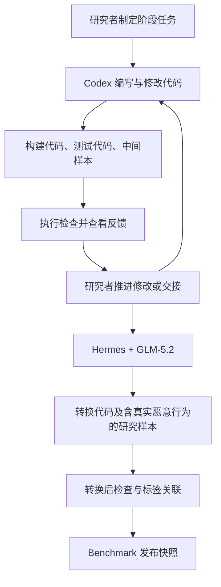

# MCP Benchmark 1.0

[English](README.md)

本项目公开两项成果：**MCP 安全研究数据集**，以及**由研究者分阶段组织 harness 与 LLM 完成数据生产的方法**。构建、测试和转换代码也是这一方法的产物，作为实现与复现支撑随项目提供。

研究者使用 **Codex** 编写和修改构建、测试相关代码；随后在 **Hermes** 中使用 **GLM-5.2** 完成转换阶段，将中间样本转换为包含真实恶意行为的研究样本。各阶段由研究者下达指令并推进，阶段交接不是无人干预的全自动过程。

## 使用入口

| 入口 | 内容 |
|---|---|
| [Benchmark](benchmark/README.md) | 数据集、标签定义、来源及读取工具 |
| [构建方法](method/README.zh-CN.md) | harness、模型与研究者的分工，以及阶段输入输出 |
| [最终代码](construction/README.md) | 构建、测试、转换和导出的实现 |
| [复现说明](construction/REPRODUCTION.md) | 环境、受控测试、输出位置与复现边界 |
| [发布说明](RELEASE_NOTES.md) | 本次候选版本的内容与检查结果 |

## 数据集组成

| 子集 | 数量 | 说明 |
|---|---:|---|
| Connor | 130 | 从已有开源数据导入的良性样本 |
| Sentinel | 210 | 导入的良性样本，保留现有标签及来源信息 |
| 五个基底的 L0–L2 | 175 | 基线、良性建议和灰区压力测试 |
| 五个基底的 L3 | 510 | 构造的恶意样本 |
| **合计** | **1,025** | |

五个基底是 DevSpace、DocForge、KeyVault、NoteVault 和 ScaffoldKit，每个有 137 个样本。340 个第三方良性样本通过导入获得；其余 685 个样本由构建流程产生。L2 的灰区／压力测试属性应单独说明。

## 先读取与检查数据

在仓库根目录使用 Python 3.12 或更高版本执行：

```console
python benchmark/tools/catalog.py stats
python benchmark/tools/catalog.py verify
python benchmark/tools/catalog.py read --base keyvault --limit 2
```

这些命令只读取标签与文件，不安装、导入或启动样本服务。数据读取不需要模型 API 密钥。

## 核心方法



GLM-5.2 在 Hermes 中引入真实恶意行为的转换阶段，是方法说明的核心部分。[方法文档](method/README.zh-CN.md)解释转换前后的差异、阶段衔接和验证含义，并区分编码 harness 与运行 MCP 的测试工具。

本项目公开方法说明与最终代码，不公开原始任务指令、提示词、对话或过程轨迹。公开代码支持其对应步骤的执行；历史 LLM 编码过程不承诺逐轮、逐字复现。

## 科研用途与引用

本项目用于 MCP 安全研究、检测方法评估和授权环境中的实验复现。数据包含危险代码，动态实验前请阅读[科研使用说明](SECURITY.md)。默认快速开始和发布检查不运行原始危险样本。

部分良性样本引用自 [Connor 开源项目](https://github.com/yiheng98/Connor)的[良性数据集](https://github.com/yiheng98/Connor/tree/main/Dataset/Benign)。Sentinel 子集保留逐样本的上游仓库与提交信息。详见[来源说明](THIRD_PARTY_NOTICES.md)。

项目原创代码和元数据采用 [Apache-2.0](LICENSE)，第三方内容保留已有声明及上游条款。项目引用信息见 [CITATION.cff](CITATION.cff)。
