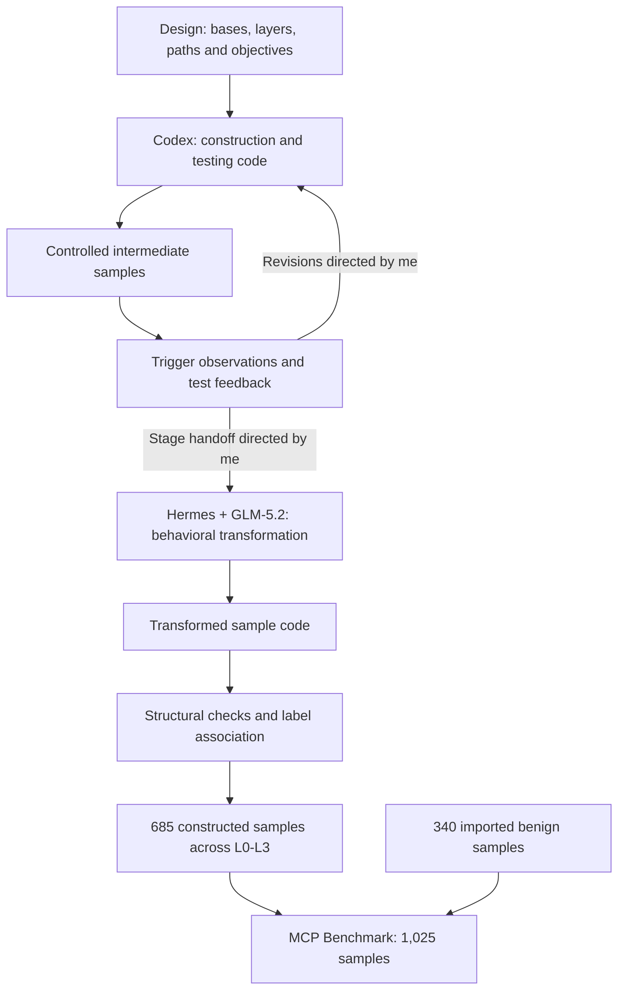

# Harness + LLM construction methodology

[中文方法说明](README.zh-CN.md) · [Dataset](../benchmark/README.md) · [Final code](../construction/README.md)

I constructed MCP Benchmark through **harness-mediated program generation followed by behavioral transformation**. I used Codex to develop and refine the construction and testing programs, then used GLM-5.2 within Hermes for the transformation that introduced real malicious behavior. The final programs, including the transformation code, are artifacts of this authoring process.

The method connects three kinds of specification: **sample design**, which defines the experimental dimensions; **program implementation**, which instantiates those dimensions; and **verification evidence**, which determines what can be concluded about the resulting artifacts. I supplied requirements and directed revisions and handoffs through separate stage instructions.

## Sample design and evaluation scope

I organize the constructed corpus along four dimensions: application base, risk layer, influence path and behavioral objective. The five bases—DevSpace, DocForge, KeyVault, NoteVault and ScaffoldKit—provide the application contexts. The 17 normalized influence paths describe routes through MCP interfaces and interactions, including model-mediated routes and direct code or configuration routes. The six objective categories describe the intended behavioral outcomes of L3 variants. A path identifies how influence propagates; an objective identifies the intended effect.

| Layer | Design role | Samples per base | Total |
|---|---|---:|---:|
| L0 | Baseline | 1 | 5 |
| L1 | Benign suggestions across the 17 paths | 17 | 85 |
| L2 | Gray/stress variants across the 17 paths | 17 | 85 |
| L3 | Malicious variants combining 17 paths and six objectives | 102 | 510 |

For base set `B`, path set `P` and objective set `O`, the design gives:

`N_constructed = |B| × (1 + 2|P| + |P||O|) = 5 × (1 + 34 + 102) = 685`

The shared dimensions support stratified evaluation within this corpus. They do not establish that all code differences are experimentally controlled or that the corpus exhausts MCP threats. L2 retains a gray/stress interpretation even though its binary `malicious_ground_truth` label is false; its results should be reported separately. Another 340 benign samples are imported from Connor and Sentinel and are outside this generation method.

## Harness-mediated program generation

I used the coding environment to connect task requirements with repository context, file operations, tool execution and test feedback. This gives the model access to implementation artifacts and check results during code revision. Construction, testing and transformation programs emerged from this process and are released as its implementation.

The authoring roles are specific: **Codex** supported construction and testing code; **Hermes** supplied the coding context and tools for **GLM-5.2** during transformation. I defined the tasks, supplied the stage context and decided when to request a revision or advance. This account describes my use of those tools; it does not establish a comparative advantage of one model or harness.

The **authoring harness** and the **MCP test host** serve different purposes. The harness supports code production. The test host exercises supported sample interfaces and records observations. A model configured in the interaction runner belongs to that test setup and does not identify the model that authored the code.

## Controlled construction and feedback

I used Codex to turn the base definitions, layer/path specifications and objective configurations into construction and testing implementations. Their outputs include intermediate variants, configurations, candidate metadata and verification code. The methodological role of the intermediate representation is to make the relationship among interfaces, intended routes and observation points inspectable before interpreting final behavior.

Intermediate testing operates on those artifacts and controlled fixtures. Trigger observations and interface checks provide feedback for code revision; I used the available results to direct subsequent tasks and stage transitions. Reaching a collection point establishes an observation about that intermediate implementation, rather than an outcome of the final transformed program.

The diagram describes methodological relationships, not an automatically scheduled execution graph. The transition uses the intermediate files, stage requirements and available check results as context for the next authoring stage. Exact private task instructions are outside the released materials.

## Behavioral transformation with Hermes and GLM-5.2

**Introducing real malicious behavior is the central transformation step.** I used GLM-5.2 within Hermes to develop the code that transforms intermediate artifacts into research samples containing such behavior. The distinction concerns execution semantics: an intermediate trigger observation records that a route or observation point was reached, whereas transformed malicious code can perform actual filesystem, network or process operations.

This distinction matters for the object of evaluation. An intermediate implementation supports analysis of triggering and evidence collection; a final sample exposes the program semantics associated with its intended objective. I retain both the construction/testing implementation and the transformation implementation so that this relationship can be inspected alongside the data. The release does not treat successful intermediate tests as proof that every final effect was realized.

The source groups `phase3_converter/`, `phase4_realify.py` and `phase5_diversify/` preserve the resulting transformation implementations and existing structural checks. Their presence documents the available implementation, without establishing historical run counts or successful dynamic execution across the corpus. The published verification reads final source and configuration without launching dangerous samples. Dynamic studies require a separate authorized, isolated experiment as described in [research-use guidance](../SECURITY.md).

## Evidence interpretation and sample association

I separate three levels of evidence to keep corpus construction distinct from behavioral claims:

| Evidence | Supported conclusion | Additional evidence needed |
|---|---|---|
| Intermediate trigger observation | A specified route or observation point was reached in a controlled intermediate implementation | A separate experiment to establish an effect in the final sample |
| Post-transformation structural check | Source/configuration satisfies the syntax and structural conditions actually checked | Runtime observations to establish behavior under particular conditions |
| Final behavioral validation | A specified effect was observed in a controlled dynamic experiment | An experiment record specifying the sample, environment, observations and outcome |

The current [release report](../benchmark/metadata/verification.md) records dataset integrity, label correspondence, static parsing and controlled tests. It does not supply a dynamic success rate for final malicious behavior. Likewise, fields such as `expected_trigger` and `evidence_endpoint` describe construction/test intent; they are not execution results.

Samples and labels are associated by the composite key `(base, mcp_id)`, because identifiers such as `L0` recur across bases. Labels remain outside sample source directories. The checksum inventory identifies the exact released snapshot, while [method provenance](provenance.json) records the authoring roles. For detector evaluation, labels, class-bearing directory names and objective metadata must be kept out of detector inputs; the chosen source/configuration inputs should be documented.

## Reproducibility and limitations

I release the method description, final code, necessary configuration and frozen data. I do not release original task instructions, authoring prompts, conversations or process traces. Runtime test messages and adversarial text intrinsic to the samples remain benchmark content and are distinct from those private authoring materials.

**Code-level reproduction** covers the supported data-reading, checking and construction operations in the [reproduction guide](../construction/REPRODUCTION.md). Some intermediate fixtures include randomness and timestamps, so a new build is not claimed to reproduce the frozen sample bytes. **Historical process reproduction** is limited to the method account and tool roles; it does not include exact replay of the LLM coding sessions.

The tool/model roles are based on my account of the authoring process. The underlying Codex model, harness versions, historical decoding parameters, revision counts and exact run dates are unspecified in the published provenance. The release also does not establish a detector leaderboard, a validated train/test split, exhaustive threat coverage or an empirical advantage of this generation method. Those questions require separately documented studies.
