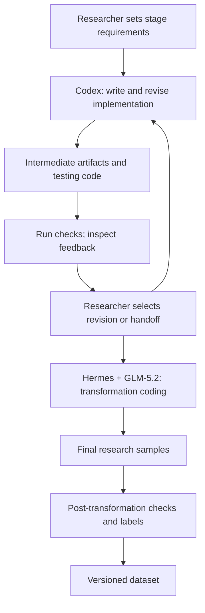

# Researcher-directed harness and LLM construction method

[中文方法说明](README.zh-CN.md) · [Dataset](../benchmark/README.md) · [Final code](../construction/README.md)

The method uses coding-agent environments to produce and revise the programs that construct an MCP benchmark. The researcher directs successive stages. Codex supports construction and testing code; Hermes with GLM-5.2 supports the transformation introducing real malicious behavior. The programs are implementation artifacts of this process.

## Roles and stage control

| Participant | Responsibility |
|---|---|
| Researcher | Defines stage requirements, supplies context and chooses when to revise or hand off |
| Codex | Writes and revises construction and testing code in the coding environment |
| Hermes | Supplies coding context, file access and tools for GLM-5.2 |
| GLM-5.2 | Performs transformation-stage coding work inside Hermes |
| MCP test host and verification scripts | Exercise supported intermediate interfaces and record observations; distinct from the authoring harness |

These roles are researcher-reported provenance. The underlying Codex model, harness versions, historical decoding parameters, revision counts and exact run dates are not recorded in the released provenance. No comparison of model capability is claimed.

## Stage flow and handoffs

| Stage | Inputs | Outputs and interpretation |
|---|---|---|
| Construction | Five base designs, layer/path definitions and objective configuration | Construction code, verification code, intermediate variants and candidate metadata |
| Intermediate testing | Intermediate code/configuration and synthetic fixtures | Trigger observations and test results; failures inform researcher-directed revision |
| Researcher handoff | Intermediate artifacts, requirements and available check results | Context for the Hermes + GLM-5.2 stage |
| Transformation | Stage inputs and transformation requirements | Transformation implementation and samples containing real malicious behavior |
| Post-transformation checks | Final source/configuration and label definitions | Structural results and sample-to-label association; dynamic results require separate evidence |
| Export | Final files, imported benign samples and labels | Dataset snapshot and integrity metadata |

The stage handoff is directed by the researcher. This repository does not implement a new scheduler automatically coordinating Codex, Hermes and GLM-5.2.

## Transformation as a central part of the method

Intermediate variants support controlled trigger observation and evidence collection. GLM-5.2 inside Hermes produced the implementation work transforming those artifacts into samples with actual malicious effects. Final sample code can contain real filesystem, network or process behavior.

The source tree preserves the resulting transformation stages and existing checks. Their presence does not demonstrate that every final behavior was executed successfully. Default release verification reads source and configuration without launching dangerous samples.

Three result types remain distinct:

1. **Intermediate trigger evidence**: a specified route or collection point was reached in the controlled intermediate implementation.
2. **Structural conversion checks**: source/configuration is syntactically valid and matches checked structural expectations.
3. **Final behavior validation**: an effect was observed in a separately controlled dynamic experiment. This requires an experiment record and is not inferred from the first two checks.

The coding model is distinct from any model configured in the MCP interaction runner. An interaction-runner API setting does not establish which model authored the code.

## Dataset association

Five bases contribute 685 constructed samples. Each has L0 (1), L1 (17), L2 (17) and L3 (102). There are 17 normalized paths; L3 combines those paths with six objective categories. Connor and Sentinel imports contribute another 340 benign samples, which were not generated by this coding workflow.

Labels remain outside sample directories. Composite identity is `(base, mcp_id)`, because names such as `L0` repeat across bases. The checksum inventory identifies the release snapshot; stage provenance describes how its implementation was produced.

## Reproduction and disclosure

The release includes final code, configuration, data and method descriptions. Original task instructions, authoring prompts, conversations and process traces are not released. Development plans are summarized into this account rather than distributed as instructions to a coding agent.

Code-level reproduction means executing supported published steps with documented inputs. Historical LLM authoring is disclosed methodologically, not as a replayable transcript. Generated fixtures include randomness and timestamps, so a new intermediate build is not promised to be byte-identical to the frozen dataset.

Runtime test messages and adversarial text intrinsic to a sample remain research content; they are not the private prompts used to author the project. See [reproduction](../construction/REPRODUCTION.md) and [research use](../SECURITY.md).
