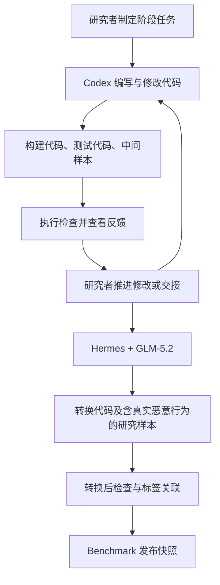

# 研究者分阶段组织的 Harness 与 LLM 构建方法

[English](README.md) · [数据集](../benchmark/README.md) · [最终代码](../construction/README.md)

本方法的核心是：研究者使用编码 Agent 环境，让 LLM 参与编写和修改构建、测试与转换代码，并通过分阶段任务推进数据生产。Codex 负责构建与测试相关编码；Hermes 为 GLM-5.2 提供编码环境，后者完成引入真实恶意行为的转换阶段。公开代码是这一方法的产物与复现支撑。

## 角色分工

| 参与者 | 职责 |
|---|---|
| 研究者 | 制定阶段任务、提供上下文，并决定修改或进入下一阶段 |
| Codex | 编写和修改构建、测试相关代码，支持中间样本形成 |
| Hermes | 为 GLM-5.2 提供上下文、文件操作与工具执行环境 |
| GLM-5.2 | 在 Hermes 中完成转换阶段的编码工作 |
| MCP 测试 host 和验证脚本 | 执行受控中间样本的测试并记录观察结果 |

编码 harness 帮助模型编写和修改代码；MCP 测试工具运行被测接口、收集结果。交互测试中配置的模型，也不能直接当作编写这些代码的模型。

上述模型与环境分工来自研究者说明。未记录的 Codex 底层模型、harness 版本、历史参数、修改轮次及准确日期不作推断，也不据此比较模型能力。

## 构建、测试与阶段交接

研究者首先提供基底设计、层级、路径和目标要求，在 Codex 中推进构建与测试代码的形成。代码生成中间样本、配置和候选标签；测试结果用于判断接口、路径及证据收集是否符合要求。研究者查看反馈后继续下达修改任务，或把已有文件、阶段要求和可用检查结果交给下一阶段。

这些步骤由研究者分阶段推进。公开实现保留阶段产物，不增加自动协调 Codex、Hermes 和 GLM-5.2 的新调度平台。

## Hermes 与 GLM-5.2 的转换阶段

转换是本方法的核心环节。受控中间版本支持触发观察和证据收集；研究者随后通过 Hermes 驱动 GLM-5.2 完成转换相关编码，将中间版本转换为包含真实恶意行为的研究样本。转换前后的关键差异是执行语义：最终代码可能包含实际文件操作、网络行为和进程行为。

方法说明保留阶段输入、输出和检查含义；最终代码保留已有转换实现。默认发布检查只读取源码和配置，不启动危险样本。

以下三种结果分别解释：

1. **中间版本触发验证**：在受控实现中到达了指定路径或证据收集位置。
2. **转换后的结构检查**：源码或配置通过语法及相应结构检查。
3. **最终行为验证**：在另行控制的动态实验中观察到实际效果，需要独立实验依据。

前两种结果不能自动证明第三种结果。源码存在某种行为，也不等于该行为已在所有样本中成功执行。

## 与 Benchmark 的关系

五个构造基底各有 137 个样本，共 685 个：每个包含 L0 的 1 个样本、L1 的 17 个样本、L2 的 17 个样本和 L3 的 102 个样本。L3 由 17 条规范化路径与六类目标组合。另有 340 个来自 Connor 与 Sentinel 的良性样本通过导入获得。

样本源码与标签分开存放。样本标识由 `base` 和 `mcp_id` 共同确定；文件校验值确定具体发布快照。方法来源记录描述研究者使用的模型与环境，不把第三方子集归为模型生成数据。

## 公开范围与复现边界

公开方法说明、最终代码、必要配置和数据。不公开原始任务指令、编码提示词、对话或过程轨迹；开发方案经过概括后形成方法说明，不作为给 Agent 的原始任务文件发布。

代码层面的复现是使用公开实现执行其支持的步骤。由于不提供历史指令与完整记录，不承诺逐轮重放当时的 LLM 编码过程。生成的测试夹具可能包含随机数据和时间戳，因此重新构建的中间样本不承诺与冻结数据逐字节相同。

数据中原有的运行时测试消息和对抗文本属于 benchmark 内容，与编写项目时的私人编码指令不同。动态实验前请阅读[科研用途说明](../SECURITY.md)，可运行范围见[复现文档](../construction/REPRODUCTION.md)。
