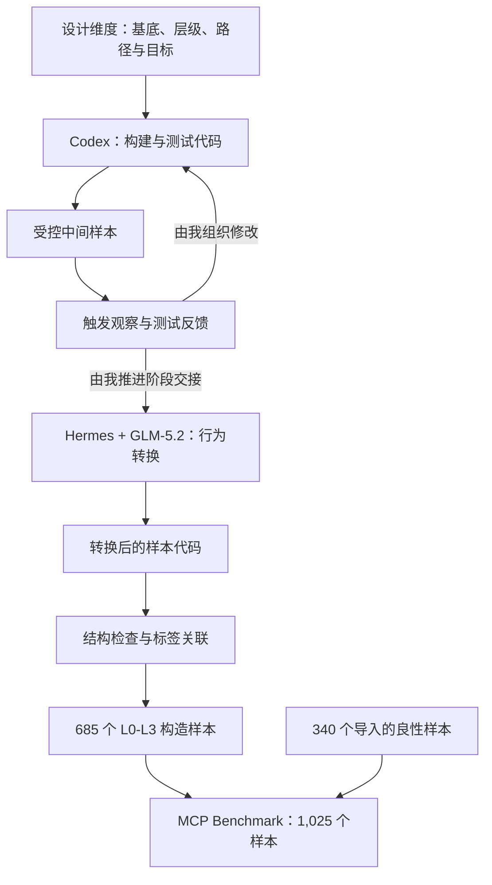

# Harness + LLM 数据构建方法

[English](README.md) · [数据集](../benchmark/README.md) · [最终代码](../construction/README.md)

我通过 **harness 支持下的程序生成与后续行为转换**构建 MCP Benchmark：先使用 Codex 编写和迭代构建、测试程序，再在 Hermes 中使用 GLM-5.2，完成引入真实恶意行为的转换。最终程序，包括转换代码本身，均是这一编码过程的产物。

该方法连接三个层面的表达：定义实验维度的**样本设计**、将这些维度具体化的**程序实现**，以及界定结论范围的**验证证据**。我为各阶段提供要求，并通过分别下达指令推进修改与交接。

## 样本设计与评估范围

我以应用基底、风险层级、影响路径和行为目标四个维度组织构造子集。DevSpace、DocForge、KeyVault、NoteVault 和 ScaffoldKit 五个基底提供应用情境；17 条规范化影响路径描述 MCP 接口与交互中的作用链路，包括经过模型的路径，以及直接作用于代码或配置的路径；六类行为目标定义 L3 变体预期产生的行为结果。路径刻画影响如何传递，目标刻画预期产生什么效果。

| 层级 | 设计作用 | 每个基底的样本数 | 总数 |
|---|---|---:|---:|
| L0 | 基线 | 1 | 5 |
| L1 | 覆盖 17 条路径的良性建议样本 | 17 | 85 |
| L2 | 覆盖 17 条路径的灰区／压力样本 | 17 | 85 |
| L3 | 17 条路径与六类目标组合的恶意样本 | 102 | 510 |

记基底集合为 `B`、路径集合为 `P`、目标集合为 `O`，构造子集的规模为：

`N_constructed = |B| × (1 + 2|P| + |P||O|) = 5 × (1 + 34 + 102) = 685`

共同的设计维度支持在数据集内部开展分层评估，但并不证明所有代码差异都受到实验控制，也不意味着穷尽 MCP 威胁。尽管 L2 的二分类字段 `malicious_ground_truth` 为 false，其灰区／压力测试含义仍需保留，评估时应单独报告。此外，340 个良性样本从 Connor 和 Sentinel 导入，不属于这一生成方法的产物。

## Harness 支持下的程序生成

我使用编码环境将任务要求与仓库上下文、文件操作、工具执行和测试反馈联系起来，使模型能够在修改代码时访问已有实现与检查结果。构建、测试和转换程序由这一过程形成，并作为方法实现公开。

各工具承担明确的阶段职责：**Codex** 支持构建与测试相关代码的编写；**Hermes** 在转换阶段为 **GLM-5.2** 提供编码上下文与工具。我负责定义任务、提供阶段上下文，并决定继续修改还是进入下一阶段。这里记录的是我对这些工具的实际使用方式，不据此推断某个模型或 harness 更具优势。

**编码 harness** 与 **MCP 测试 host** 具有不同作用：前者支持程序生成，后者运行受支持的样本接口并记录观察结果。交互测试中配置的模型属于测试设置，不能据此判断编写代码时使用了什么模型。

## 受控构建与反馈

我使用 Codex 将基底定义、层级与路径规范、目标配置转化为构建和测试实现，形成中间变体、配置、候选元数据和验证代码。中间表示的方法作用，是在解释最终行为之前，使接口、预期路径与观察点之间的关系能够被检查。

中间测试以这些产物及受控夹具为输入，利用触发观察和接口检查提供修改依据。我根据可用结果安排后续任务和阶段转换。到达某个证据收集位置，只能支持对当前中间实现的观察结论，不能直接作为最终转换程序的行为结果。

图中表示方法关系，而非自动调度的执行图。阶段交接以中间文件、阶段要求和可用检查结果作为后续编码任务的上下文；具体的私人任务指令不在公开范围内。

## Hermes + GLM-5.2 的行为转换

**引入真实恶意行为是本方法的核心转换环节。** 我在 Hermes 中使用 GLM-5.2 编写转换相关代码，将中间产物转换为包含此类行为的研究样本。转换前后的关键差异在于执行语义：中间版本的触发观察记录某条路径或观察点被到达；转换后的恶意代码则可能执行实际的文件、网络或进程操作。

这一差异决定了评估对象的含义。中间实现支持触发机制与证据收集的分析，最终样本则呈现与预期目标相关的程序语义。我同时保留构建／测试实现和转换实现，使这种对应关系能够结合数据接受检查。中间测试通过，不能直接证明最终效果在所有样本上均已实现。

`phase3_converter/`、`phase4_realify.py` 和 `phase5_diversify/` 保留了最终形成的转换实现与已有结构检查。代码的存在说明当前可检查的实现内容，不足以推断历史运行轮次或整个数据集的动态执行成功情况。发布验证读取最终源码与配置，不启动危险样本。动态研究需按照[科研用途说明](../SECURITY.md)，在另行授权与隔离的实验环境中开展。

## 证据解释与样本关联

我区分三个证据层次，以明确数据构建结果能够支持哪些行为结论：

| 证据类型 | 能够支持的结论 | 仍需补充的依据 |
|---|---|---|
| 中间版本触发观察 | 在受控中间实现中到达了指定路径或观察点 | 若要判断最终样本的效果，需要独立实验 |
| 转换后的结构检查 | 源码或配置满足实际检查过的语法与结构条件 | 若要判断具体条件下的行为，需要运行时观察 |
| 最终行为验证 | 在受控动态实验中观察到指定效果 | 需记录样本、环境、观察内容与实验结果 |

当前[发布检查报告](../benchmark/metadata/verification.md)涵盖数据完整性、标签对应、静态解析与受控测试，不提供最终恶意行为的动态成功率。同样，`expected_trigger`、`evidence_endpoint` 等字段描述构建／测试意图，不是实际执行结果。

样本与标签通过复合标识 `(base, mcp_id)` 关联，因为 `L0` 等标识会在不同基底中重复。标签与样本源码分开存放，文件校验清单确定具体发布快照，[方法来源记录](provenance.json)描述编码过程中的工具角色。开展检测评估时，应将标签、暴露类别的目录名和目标元数据排除在检测器输入之外，并记录实际提供的源码与配置内容。

## 复现范围与局限

我公开方法说明、最终代码、必要配置和冻结数据，不公开原始任务指令、编码提示词、对话或过程轨迹。样本中固有的运行时测试消息和对抗文本仍属于 benchmark 内容，与这些私人编码材料相区分。

**代码层面的复现**涵盖[复现文档](../construction/REPRODUCTION.md)支持的数据读取、检查与构建操作。部分中间夹具包含随机数据和时间戳，因此重新构建不承诺得到与冻结样本逐字节一致的结果。**历史过程层面的复现**限于方法说明与工具分工，不包含当时 LLM 编码会话的精确重放。

工具与模型角色来自我对实际编码过程的说明。公开来源记录未指定 Codex 底层模型、harness 版本、历史解码参数、修改轮次及准确运行日期。当前版本也不提供检测器排行榜、经验证的训练／测试划分、穷尽性的威胁覆盖，或这一生成方法具有优势的实证结论；这些问题需要独立记录的实验加以回答。
